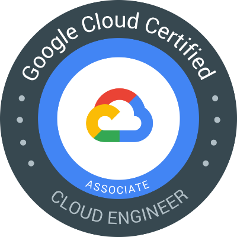

  

<h2>Hello!  I'm Pavithra Nagaraj,</h2>

**Senior Cloud Platform Engineer** based in Dublin, Ireland, with 8+ years designing, automating and securing public cloud platforms across **GCP, Azure and AWS** at enterprise scale (1,800+ projects).

I'm a software developer in **Python and Go** who builds internal self-service platforms, APIs and event-driven automation, backed by Terraform, CI/CD, observability and a strong IAM, networking and governance practice. Experienced in **PCI DSS, ISO 27001 and SOC 2** environments.

 

Click 👉 <a href="https://pavithranagaraj26.github.io/"> Portfolio </a>

## 🚀 What I do

- **Cloud platforms and governance:** cloud foundations, multi-cloud and multi-tenant architecture, project lifecycle and cost-driven decommissioning
- **Identity and security:** least-privilege IAM, cross-cloud Workload Identity Federation (Azure to GCP), Security Command Center automation
- **Automation and tooling:** Python and Go services, event-driven functions, internal self-service platforms and an MCP server
- **Delivery and reliability:** Terraform, GitOps, CI/CD, Kubernetes (GKE, AKS), observability with Grafana, Loki and Prometheus, incident ownership and RCA

## 🏢 Experience

| Role | Company | Period |
|------|---------|--------|
| Cloud Platform Engineer | Activision Blizzard King, Dublin | Sep 2023 - Present |
| Senior GCP DevOps Engineer | HCL Technology, Bangalore | Aug 2022 - Aug 2023 |
| Cloud DevOps Engineer | DXC Technology, Bangalore | Apr 2021 - Aug 2022 |
| Cloud DevOps Engineer | Impact Analytics, Bangalore | Dec 2019 - Apr 2021 |
| Cloud DevOps Analyst | Deloitte Consulting US India, Bangalore and Hyderabad | Nov 2017 - Sep 2019 |

## 🎓 Certifications

- Google Cloud Professional Cloud Architect
- Google Cloud Associate Cloud Engineer
- HashiCorp Certified: Terraform Associate
- Microsoft Certified: Azure Fundamentals
- Certified Jenkins Engineer (2021)
- PCEP - Certified Entry-Level Python Programmer

## 💻 Technologies I Love ❤️

  

